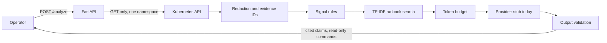

# Kubernetes Incident Assistant (P04)

Read-only assistant that collects Kubernetes evidence, retrieves runbooks and returns explanations where every claim cites its evidence. It is local-only.

**LLM status:** no LLM is connected. The active provider is a deterministic stub, labelled in every response as `stub (deterministic, not an LLM)`. It formats rule-detected signals, so the current output shows the pipeline and its safety controls, not AI answer quality.

## Architecture



## Safety controls

| Risk | Control | Test |
|---|---|---|
| Assistant changes the cluster | Role allows only `get` and `list` on Pods, logs and events in `incident-lab`, with no ClusterRole and no Secrets | `tests/verify-live.sh` |
| Secrets in logs reach a provider | Redaction runs before evidence is stored, returned or put in a prompt | Unit tests, eval and live fake secrets |
| Logs contain instructions | Logs are marked as untrusted data, flagged when suspicious, and can't create signals | Unit and live tests |
| Provider invents facts | Claims with missing or unknown evidence IDs are removed | Malicious-provider unit test |
| Provider suggests harmful commands | Only `kubectl get`, `describe`, `logs`, `top` and `events` pass, with no shell syntax or Secret access | Unit tests |
| Runaway cost | 4,000-token prompt cap, daily budget, and limits on log lines and evidence size | Unit tests and eval |
| Access to other namespaces | API allowlist returns 403, and RBAC also denies access | Unit and live tests |

The redaction patterns are best effort. Review them before sending real incident data to any external provider. The daily budget counter is in memory, so it resets when the Pod restarts.

## Deploy and demo

Requires the P01 kind cluster.

```bash
./scripts/deploy.sh
kubectl --context kind-local-platform -n incident-assistant port-forward svc/incident-assistant 18000:80
curl -s -X POST http://127.0.0.1:18000/analyze -H 'Content-Type: application/json' \
  -d '{"namespace":"incident-lab","workload":"lab-crashloop"}'
```

Namespace `incident-lab` holds deliberately broken workloads for crash loops, OOM kills, image pull failures, scheduling failures and probe failures, plus one healthy workload. The secrets its logs print are fake.

To remove the demo, which deletes both namespaces:

```bash
kubectl --context kind-local-platform delete namespace incident-assistant incident-lab
```

## Tests

```bash
python -m pytest
python -m eval.run
tests/verify-live.sh
```

`eval.run` runs 12 synthetic incidents and 10 free-text queries, and exits non-zero if a target is missed. It measures signal detection, retrieval, citations, secret leaks and prompt size. It does not measure LLM answer quality. Its samples were written alongside the rules, so its scores show regressions, not real-world accuracy.

## Connecting an LLM

Implement the `Provider` protocol in `assistant/llm.py`, and evaluate it with real answers before relying on it. Set the API key outside this repository. Its output already passes through the same validation.

## Troubleshooting

| Symptom | Cause | Fix |
|---|---|---|
| Healthy workload once reported `Unhealthy` | A probe event from normal startup outlives the startup | Events on Pods that are ready with zero restarts are kept as evidence but create no signal |
| `/analyze` returns 403 | Namespace is not in `ALLOWED_NAMESPACES` | Add it, and add a matching Role |
| `/analyze` returns 502 | The Kubernetes API request failed | Check the Role, RoleBinding and API server access |

## Phase 2 improvements

- Connect and evaluate a real LLM provider.
- Replace TF-IDF with embeddings and a vector store.
- Add API authentication, because the Service is ClusterIP with none.
- Evaluate on real incident data, and persist the token budget.
- Add Deployment and node evidence, and more signal types.
